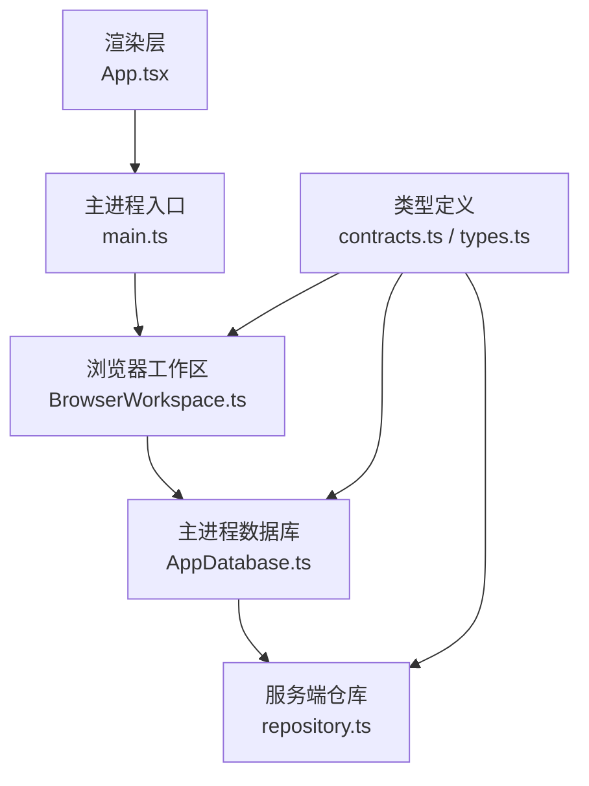
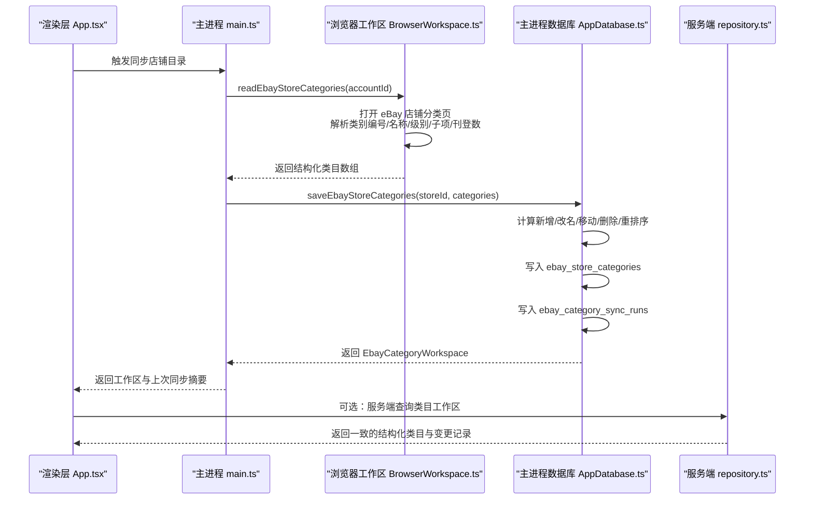
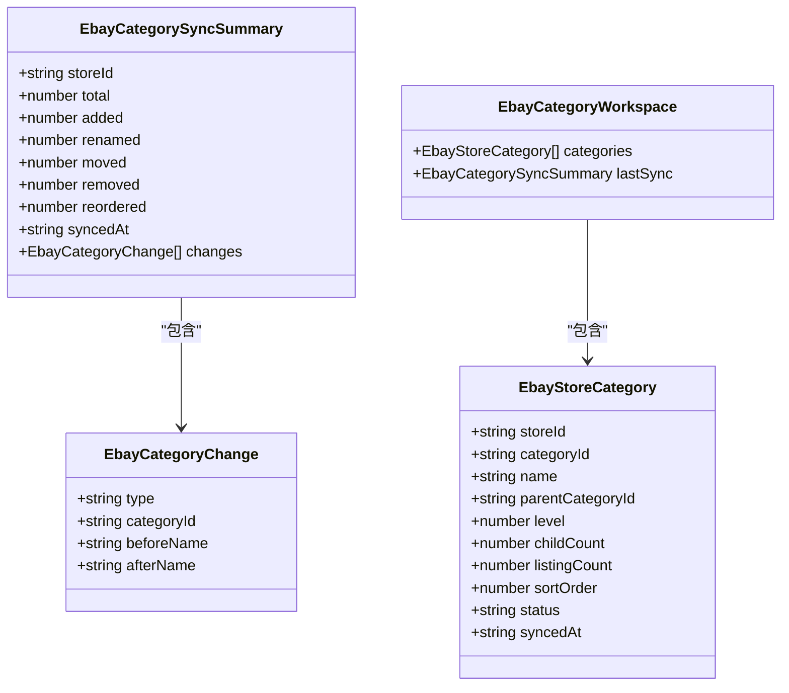
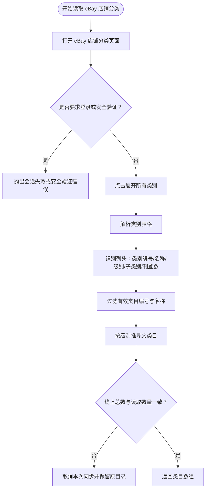
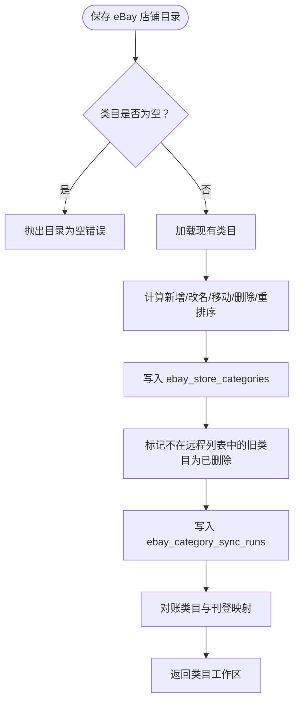
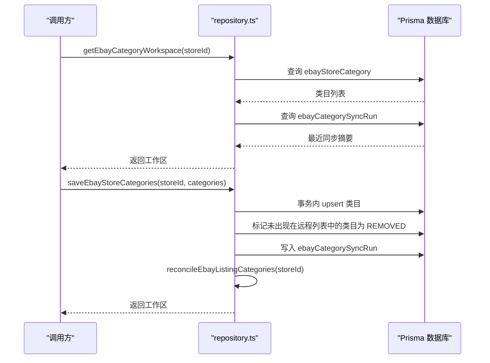
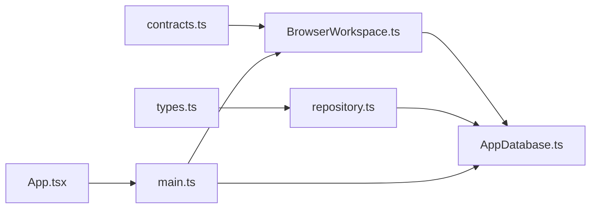

# eBay平台分类系统

<cite>
**本文引用的文件 **   
- [AppDatabase.ts](file://src/main/database/AppDatabase.ts)
- [BrowserWorkspace.ts](file://src/main/browser/BrowserWorkspace.ts)
- [contracts.ts](file://src/shared/contracts.ts)
- [types.ts](file://server/src/modules/ebay/types.ts)
- [repository.ts](file://server/src/modules/ebay/repository.ts)
- [main.ts](file://src/main/main.ts)
- [App.tsx](file://src/renderer/App.tsx)
</cite>

## 目录
1. [引言](#引言)
2. [项目结构定位](#项目结构定位)
3. [核心组件](#核心组件)
4. [架构总览](#架构总览)
5. [详细组件分析](#详细组件分析)
6. [依赖关系分析](#依赖关系分析)
7. [性能与一致性特征](#性能与一致性特征)
8. [故障排查指南](#故障排查指南)
9. [结论](#结论)

## 引言
本文件聚焦“砚都跨境”桌面应用中与 eBay 平台分类（店铺目录）相关的数据模型、抓取、持久化、同步与变更追踪机制。该能力负责：
- 从 eBay 卖家后台读取店铺目录；
- 将类目树结构化存储为本地工作区；
- 记录每次同步的变更明细；
- 在服务器端提供一致的类目工作区接口；
- 驱动后续目录商品采集、刊登类目映射与合规校验等流程。

## 项目结构定位
eBay 分类系统横跨三个层次：
- 浏览器层：通过 Electron WebContentsView 打开 eBay 店铺分类页面，解析表格并构建类目树；
- 主进程数据库层：使用 SQLite 持久化类目、同步快照与变更记录；
- 服务端模块：提供 Prisma 数据访问、类型定义与 API 可复用的类目工作区能力；
- 渲染层：触发同步、展示结果与错误提示。

**图表来源**
- [App.tsx:3537-3546](file://src/renderer/App.tsx#L3537-L3546)
- [main.ts:3322-3425](file://src/main/main.ts#L3322-L3425)
- [BrowserWorkspace.ts:2358-2407](file://src/main/browser/BrowserWorkspace.ts#L2358-L2407)
- [AppDatabase.ts:2373-2407](file://src/main/database/AppDatabase.ts#L2373-L2407)
- [repository.ts:1116-1253](file://server/src/modules/ebay/repository.ts#L1116-L1253)
- [contracts.ts:380-400](file://src/shared/contracts.ts#L380-L400)
- [types.ts:224-261](file://server/src/modules/ebay/types.ts#L224-L261)

**章节来源**
- [App.tsx:3537-3546](file://src/renderer/App.tsx#L3537-L3546)
- [BrowserWorkspace.ts:2358-2407](file://src/main/browser/BrowserWorkspace.ts#L2358-L2407)
- [AppDatabase.ts:2373-2407](file://src/main/database/AppDatabase.ts#L2373-L2407)
- [repository.ts:1116-1253](file://server/src/modules/ebay/repository.ts#L1116-L1253)
- [contracts.ts:380-400](file://src/shared/contracts.ts#L380-L400)
- [types.ts:224-261](file://server/src/modules/ebay/types.ts#L224-L261)

## 核心组件
- 类目数据模型：`EbayStoreCategory`、`EbayCategoryChange`、`EbayCategorySyncSummary`、`EbayCategoryWorkspace`；
- 浏览器抓取器：`readEbayStoreCategories`；
- 主进程持久化：`getEbayCategoryWorkspace`、`saveEbayStoreCategories`；
- 服务端仓库：`getEbayCategoryWorkspace`、`saveEbayStoreCategories`；
- 渲染层交互：触发同步、展示上次同步摘要与错误信息。

**章节来源**
- [contracts.ts:380-400](file://src/shared/contracts.ts#L380-L400)
- [types.ts:224-261](file://server/src/modules/ebay/types.ts#L224-L261)
- [BrowserWorkspace.ts:2358-2407](file://src/main/browser/BrowserWorkspace.ts#L2358-L2407)
- [AppDatabase.ts:2373-2407](file://src/main/database/AppDatabase.ts#L2373-L2407)
- [repository.ts:1116-1253](file://server/src/modules/ebay/repository.ts#L1116-L1253)
- [App.tsx:3537-3546](file://src/renderer/App.tsx#L3537-L3546)

## 架构总览
eBay 分类系统的整体调用链如下：

**图表来源**
- [App.tsx:3537-3546](file://src/renderer/App.tsx#L3537-L3546)
- [main.ts:3322-3425](file://src/main/main.ts#L3322-L3425)
- [BrowserWorkspace.ts:2358-2407](file://src/main/browser/BrowserWorkspace.ts#L2358-L2407)
- [AppDatabase.ts:2373-2407](file://src/main/database/AppDatabase.ts#L2373-L2407)
- [repository.ts:1116-1253](file://server/src/modules/ebay/repository.ts#L1116-L1253)

## 详细组件分析

### 类目数据模型
类目模型统一描述一个 eBay 店铺中的分类节点，包含商店标识、类目编号、名称、父类目、层级、子项数量、刊登数量、排序、状态与同步时间。变更记录用于审计每次同步带来的变化。

**图表来源**
- [contracts.ts:380-400](file://src/shared/contracts.ts#L380-L400)
- [types.ts:224-261](file://server/src/modules/ebay/types.ts#L224-L261)

**章节来源**
- [contracts.ts:380-400](file://src/shared/contracts.ts#L380-L400)
- [types.ts:224-261](file://server/src/modules/ebay/types.ts#L224-L261)

### 浏览器抓取器：从 eBay 店铺分类页提取类目
浏览器工作区负责：
- 打开 eBay 店铺分类页面；
- 等待登录与安全验证通过；
- 展开所有类目；
- 解析表格列头，识别类别编号、名称、级别、子类别数量、刊登数量；
- 过滤有效类目编号；
- 根据级别推导父类目；
- 校验线上类目总数与去重数量；
- 返回结构化类目数组。

**图表来源**
- [BrowserWorkspace.ts:2365-2407](file://src/main/browser/BrowserWorkspace.ts#L2365-L2407)

**章节来源**
- [BrowserWorkspace.ts:2365-2407](file://src/main/browser/BrowserWorkspace.ts#L2365-L2407)

### 主进程数据库：类目工作区与同步变更
主进程数据库承担两类职责：
- 读取类目工作区：返回当前活跃类目与最近一次同步摘要；
- 保存类目：对比新旧类目，统计新增、改名、移动、删除、重排序，写入类目表与同步运行记录，并执行类目与刊登映射的对账。

**图表来源**
- [AppDatabase.ts:2381-2407](file://src/main/database/AppDatabase.ts#L2381-L2407)

**章节来源**
- [AppDatabase.ts:2373-2407](file://src/main/database/AppDatabase.ts#L2373-L2407)

### 服务端仓库：类目工作区 API
服务端仓库提供与主进程一致的类目工作区能力，但基于 Prisma 与数据库模型：
- `getEbayCategoryWorkspace`：按商店查询活跃类目与最近同步记录；
- `saveEbayStoreCategories`：事务内完成类目 upsert、删除标记、同步记录写入与类目对账。

**图表来源**
- [repository.ts:1116-1253](file://server/src/modules/ebay/repository.ts#L1116-L1253)

**章节来源**
- [repository.ts:1116-1253](file://server/src/modules/ebay/repository.ts#L1116-L1253)

### 渲染层：同步触发与结果展示
渲染层负责：
- 调用桌面 IPC 触发类目同步；
- 更新类目工作区；
- 根据上次同步摘要判断首次同步、检测到变化或未变化；
- 展示错误或成功提示。

**章节来源**
- [App.tsx:3537-3546](file://src/renderer/App.tsx#L3537-L3546)

## 依赖关系分析
- 类型契约：`contracts.ts` 与 `types.ts` 分别定义共享类型与服务端类型，保证前后端数据结构一致；
- 浏览器抓取器依赖 DOM 选择器与 eBay 页面结构，需保持与 eBay 前端类名和文案兼容；
- 主进程数据库依赖 SQLite 表结构与 SQL 语句；
- 服务端仓库依赖 Prisma schema 与数据库迁移；
- 渲染层依赖 IPC 通道与桌面 API。

**图表来源**
- [contracts.ts:380-400](file://src/shared/contracts.ts#L380-L400)
- [types.ts:224-261](file://server/src/modules/ebay/types.ts#L224-L261)
- [BrowserWorkspace.ts:2358-2407](file://src/main/browser/BrowserWorkspace.ts#L2358-L2407)
- [AppDatabase.ts:2373-2407](file://src/main/database/AppDatabase.ts#L2373-L2407)
- [repository.ts:1116-1253](file://server/src/modules/ebay/repository.ts#L1116-L1253)
- [App.tsx:3537-3546](file://src/renderer/App.tsx#L3537-L3546)
- [main.ts:3322-3425](file://src/main/main.ts#L3322-L3425)

**章节来源**
- [contracts.ts:380-400](file://src/shared/contracts.ts#L380-L400)
- [types.ts:224-261](file://server/src/modules/ebay/types.ts#L224-L261)
- [BrowserWorkspace.ts:2358-2407](file://src/main/browser/BrowserWorkspace.ts#L2358-L2407)
- [AppDatabase.ts:2373-2407](file://src/main/database/AppDatabase.ts#L2373-L2407)
- [repository.ts:1116-1253](file://server/src/modules/ebay/repository.ts#L1116-L1253)
- [App.tsx:3537-3546](file://src/renderer/App.tsx#L3537-L3546)
- [main.ts:3322-3425](file://src/main/main.ts#L3322-L3425)

## 性能与一致性特征
- 浏览器抓取阶段：
  - 通过多次滚动与延时加载确保分页内容完整；
  - 对类目总数进行校验，避免部分读取导致不一致；
  - 使用唯一类目编号集合去重，防止重复条目污染目录。
- 主进程数据库阶段：
  - 使用事务批量写入类目与同步记录；
  - 通过比对现有类目与远程类目集合，精确统计变更类型；
  - 对未出现在远程列表中的活跃类目标记为已删除，保留采集类目标识前缀；
  - 写入后执行类目与刊登映射对账，保证下游发布链路可用。
- 服务端仓库阶段：
  - 使用 Prisma 事务保证 upsert、删除标记与同步记录原子性；
  - 返回一致的工作区结构，便于上层聚合展示与审计。

[本节为通用性能与一致性说明，不直接分析具体代码行]

## 故障排查指南
常见错误与处理建议：
- 登录会话失效：
  - 现象：浏览器抓取器检测到登录输入框或 URL 含登录路径；
  - 处理：引导用户回到店铺采集窗口重新登录；
  - 依据：浏览器抓取器在加载分类页时检测登录态。
- 安全验证拦截：
  - 现象：页面出现验证码、安全检查或确认本人提示；
  - 处理：暂停同步，要求人工完成验证；
  - 依据：抓取器会主动抛出安全验证错误。
- 类目读取不完整：
  - 现象：线上类目总数与读取数量不一致，或存在重复类目编号；
  - 处理：取消本次同步，保留原目录，检查页面加载与网络状况；
  - 依据：抓取器在解析完成后进行总数与去重校验。
- 类目目录为空：
  - 现象：保存类目时报错目录为空；
  - 处理：确认已成功读取 eBay 店铺分类并生成类目数组；
  - 依据：主进程与服务端仓库均拒绝空目录写入。
- 类目变更异常：
  - 现象：同步摘要显示大量删除或移动；
  - 处理：核对 eBay 后台类目调整，必要时重新同步；
  - 依据：同步摘要包含新增、改名、移动、删除、重排序计数与明细。

**章节来源**
- [BrowserWorkspace.ts:2365-2407](file://src/main/browser/BrowserWorkspace.ts#L2365-L2407)
- [AppDatabase.ts:2381-2407](file://src/main/database/AppDatabase.ts#L2381-L2407)
- [repository.ts:1153-1253](file://server/src/modules/ebay/repository.ts#L1153-L1253)

## 结论
eBay 平台分类系统在“砚都跨境”中实现了从浏览器抓取到本地持久化、再到服务端仓库的一致化类目管理能力。其关键价值在于：
- 以 eBay 店铺分类页为权威来源，结构化类目树；
- 通过变更审计与同步摘要，提供可追溯的类目演进历史；
- 为主进程与服务端提供统一的类目工作区接口；
- 为后续目录商品采集、刊登类目映射与合规校验提供稳定基础。

未来可考虑：
- 增强类目解析容错，支持 eBay 前端结构微调；
- 增加类目变更告警与自动修复策略；
- 扩展类目元数据，如类目政策、必填字段与合规规则映射。

[本节为总结性内容，不直接分析具体代码行]