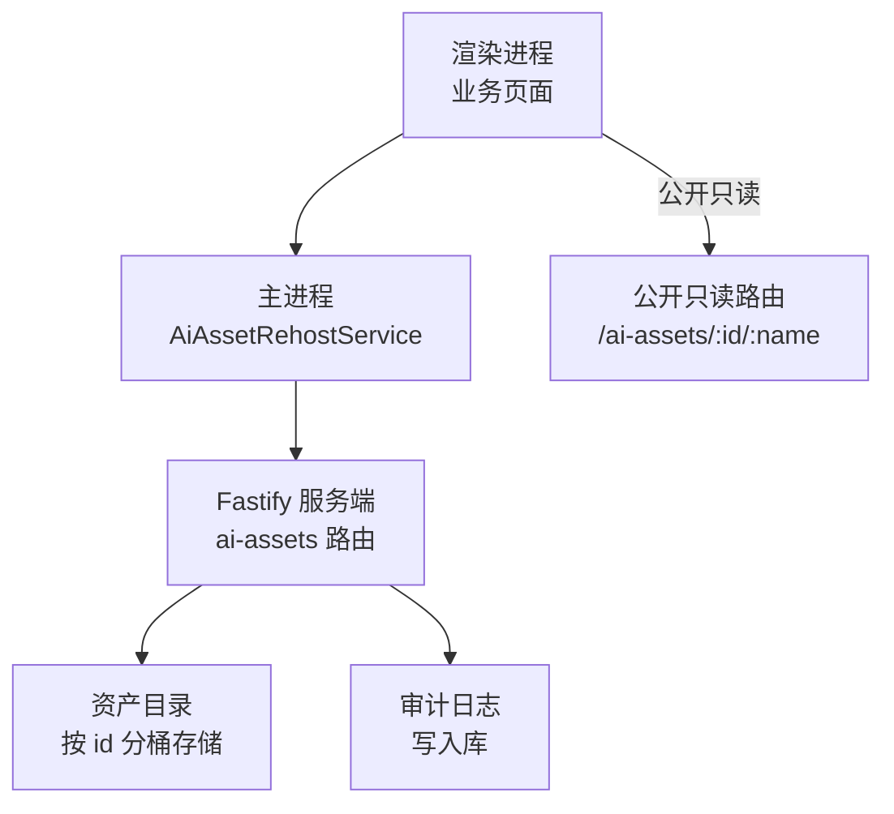
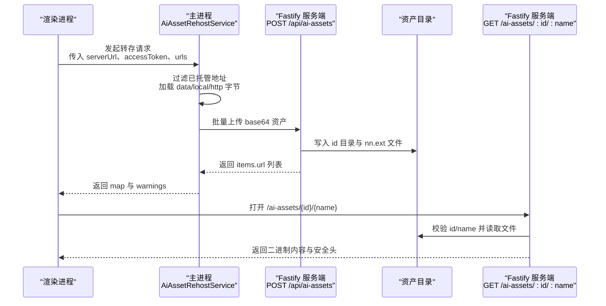
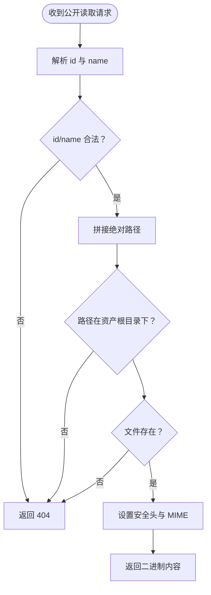
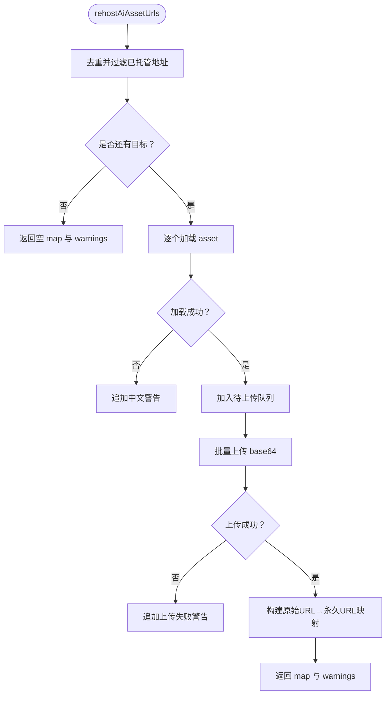
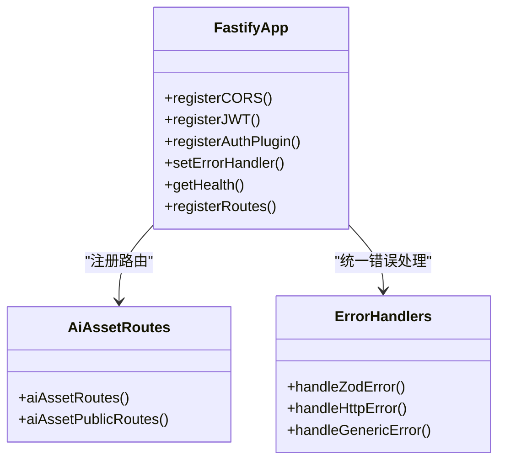
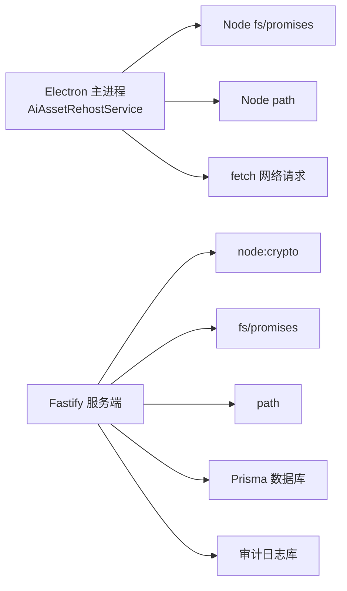

# AI资产托管系统

<cite>
**本文引用的文件**   
- [server/src/modules/ai-assets/routes.ts](file://server/src/modules/ai-assets/routes.ts)
- [src/main/services/AiAssetRehostService.ts](file://src/main/services/AiAssetRehostService.ts)
- [server/src/app.ts](file://server/src/app.ts)
- [DESIGN.md](file://DESIGN.md)
- [package.json](file://package.json)
</cite>

## 目录
1. [引言](#引言)
2. [项目结构](#项目结构)
3. [核心组件](#核心组件)
4. [架构总览](#架构总览)
5. [详细组件分析](#详细组件分析)
6. [依赖关系分析](#依赖关系分析)
7. [性能与容量特性](#性能与容量特性)
8. [故障排查指南](#故障排查指南)
9. [结论](#结论)

## 引言
本文件聚焦“AI资产托管系统”，即砚都跨境桌面工作台在 AI 生成图片与视频最终保存时，将临时资源转存到自有服务器并换取永久只读 URL 的完整链路。该系统由两部分组成：
- 桌面端转存服务：负责从 data URL、本地路径或远程地址读取字节，校验类型与安全边界，批量上传至服务器。
- 服务端托管路由：接收已登录且具备权限的请求，写入不可变资产目录，并提供公开只读的静态访问接口。

该能力用于解决 AI 生成图/视频使用 OSS 签名链接过期或仅落盘本地的风险，使优品草稿、发布任务与后续展示始终指向稳定的 `/ai-assets/{id}/{name}` 地址。

## 项目结构
围绕 AI 资产托管的关键代码分布在以下位置：
- 服务端路由：`server/src/modules/ai-assets/routes.ts`
- 桌面端转存逻辑：`src/main/services/AiAssetRehostService.ts`
- Fastify 应用装配：`server/src/app.ts`
- 设计系统与 UI 契约（背景参考）：`DESIGN.md`
- 工程入口与脚本（背景参考）：`package.json`

**图示来源**
- [server/src/modules/ai-assets/routes.ts:1-139](file://server/src/modules/ai-assets/routes.ts#L1-L139)
- [src/main/services/AiAssetRehostService.ts:1-196](file://src/main/services/AiAssetRehostService.ts#L1-L196)
- [server/src/app.ts:61-87](file://server/src/app.ts#L61-L87)

**章节来源**
- [server/src/modules/ai-assets/routes.ts:1-139](file://server/src/modules/ai-assets/routes.ts#L1-L139)
- [src/main/services/AiAssetRehostService.ts:1-196](file://src/main/services/AiAssetRehostService.ts#L1-L196)
- [server/src/app.ts:61-87](file://server/src/app.ts#L61-L87)

## 核心组件
本节梳理与 AI 资产托管直接相关的核心对象与职责。

### 服务端托管路由
- 提供两个对外暴露的路由组：
  - 需要登录与权限的批量转存 POST 接口。
  - 无需登录的公开只读 GET 接口。
- 关键约束：
  - 单次请求最多 40 个资产。
  - base64 单资产上限约 64MB，整体请求体上限 256MB。
  - 资产 ID 随机生成，文件名按序号分配，内容永不覆盖。
  - 公开响应带产品页安全头与强缓存。

**章节来源**
- [server/src/modules/ai-assets/routes.ts:1-139](file://server/src/modules/ai-assets/routes.ts#L1-L139)

### 桌面端转存服务
- 支持三类输入：
  - `data:` URL。
  - `cross-media://local/...` 与 `cross-media://project/...` 的安全本地路径。
  - `http(s):` 远程地址。
- 输出结果包含成功映射表与中文警告列表；失败不阻断保存流程。
- 对 401 返回专用认证错误，调用方可据此刷新会话并重试。

**章节来源**
- [src/main/services/AiAssetRehostService.ts:1-196](file://src/main/services/AiAssetRehostService.ts#L1-L196)

### Fastify 应用装配
- 将 `/api/ai-assets` 注册为需鉴权路由。
- 将 `/ai-assets/:id/:name` 注册为公共只读路由。
- 统一错误处理器会处理参数校验异常与业务 HTTP 错误。

**章节来源**
- [server/src/app.ts:27-89](file://server/src/app.ts#L27-L89)

## 架构总览
AI 资产托管的整体交互分为“转存阶段”和“公开访问阶段”。

**图示来源**
- [src/main/services/AiAssetRehostService.ts:145-173](file://src/main/services/AiAssetRehostService.ts#L145-L173)
- [server/src/modules/ai-assets/routes.ts:78-121](file://server/src/modules/ai-assets/routes.ts#L78-L121)
- [server/src/modules/ai-assets/routes.ts:123-137](file://server/src/modules/ai-assets/routes.ts#L123-L137)

## 详细组件分析

### 服务端托管路由分析
#### 功能要点
- 批量转存接口要求登录态，并通过权限钩子校验 `product.edit`。
- 请求体使用 schema 校验 contentType 白名单与 base64 长度。
- 每个资产写入独立目录下的顺序编号文件，并生成 meta.json 记录上传者、时间与资产清单。
- 公开读取接口严格校验 id 与 name 格式、路径越界与文件存在性，再返回二进制数据。

#### 安全设计
- 资产 ID 通过随机字节生成，避免可枚举。
- 文件名固定为两位序号加扩展名，客户端无法注入路径。
- 公开读取使用 startsWith 做根目录防护，并结合 CSP 与 sandbox 安全头。
- 上传失败时删除未完成的 id 目录，保证原子性。

**图示来源**
- [server/src/modules/ai-assets/routes.ts:123-137](file://server/src/modules/ai-assets/routes.ts#L123-L137)

**章节来源**
- [server/src/modules/ai-assets/routes.ts:1-139](file://server/src/modules/ai-assets/routes.ts#L1-L139)

### 桌面端转存服务分析
#### 输入解析与类型推断
- data URL：解析 content-type 与 base64 数据，校验扩展名映射。
- cross-media 本地路径：
  - `local` 主机限制在用户数据目录的 `ebay-local-products` 下。
  - `project` 主机限制在项目工作区内部。
- http(s) 地址：下载后根据响应头或 URL 扩展名推断类型。

#### 上传与容错
- 先收集所有可加载资产，再一次性上传。
- 单个资产加载失败只产生 warning，不中断其他资产。
- 整体上传失败时返回 warning，保留原始 URL。
- 401 直接抛出认证错误，供上层转换为会话过期提示。

**图示来源**
- [src/main/services/AiAssetRehostService.ts:145-173](file://src/main/services/AiAssetRehostService.ts#L145-L173)

**章节来源**
- [src/main/services/AiAssetRehostService.ts:1-196](file://src/main/services/AiAssetRehostService.ts#L1-L196)

### Fastify 应用装配与错误处理
- 应用启动时注册 CORS、JWT、鉴权插件。
- 全局错误处理器区分 Zod 校验错误、业务 HttpError 与通用 4xx/5xx。
- AI 资产相关路由分别挂载到 `/api/ai-assets` 与 `/ai-assets`。

**图示来源**
- [server/src/app.ts:27-89](file://server/src/app.ts#L27-L89)

**章节来源**
- [server/src/app.ts:27-89](file://server/src/app.ts#L27-L89)

## 依赖关系分析
AI 资产托管系统的依赖关系如下：

**图示来源**
- [src/main/services/AiAssetRehostService.ts:13-15](file://src/main/services/AiAssetRehostService.ts#L13-L15)
- [server/src/modules/ai-assets/routes.ts:15-24](file://server/src/modules/ai-assets/routes.ts#L15-L24)

**章节来源**
- [src/main/services/AiAssetRehostService.ts:1-196](file://src/main/services/AiAssetRehostService.ts#L1-L196)
- [server/src/modules/ai-assets/routes.ts:1-139](file://server/src/modules/ai-assets/routes.ts#L1-L139)

## 性能与容量特性
- 单次批量转存最多 40 个资产，适合“确认存入优品仓库”和“视频生成成功”这两个最终保存点。
- 单资产 base64 上限约 64MB，对应 15 秒 1080p mp4 经 base64 膨胀后的余量空间。
- 公开只读响应启用强缓存与 immutable，有利于 CDN 或浏览器缓存。
- 桌面端下载与上传均设置超时，避免长时间阻塞主流程。
- 服务端写入采用顺序编号文件名，减少客户端路径构造复杂度。

[本节为通用性能说明，不直接分析具体代码行]

## 故障排查指南
### 常见问题与定位建议
- 资产类型不支持：
  - 检查 contentType 是否在支持的 image/video 白名单内。
  - 若来自 URL，确认响应头或扩展名能映射到 jpg/png/webp/gif/avif/mp4。
- 本地路径被拒绝：
  - cross-media local 路径必须位于 `ebay-local-products` 目录内。
  - cross-media project 路径必须位于项目工作区内部。
- 401 未认证：
  - 桌面端应识别专用认证错误，触发会话刷新后重试。
- 公开资源 404：
  - 检查 id 与 name 是否符合正则，确认文件确实已写入资产目录。
- 上传体积过大：
  - 确认单个 base64 不超过上限，整体请求体不超过 256MB。
- 保存流程未阻断但资源未托管：
  - 查看 warnings；部分失败不会抛错，而是保留原 URL 并提示原因。

**章节来源**
- [src/main/services/AiAssetRehostService.ts:99-128](file://src/main/services/AiAssetRehostService.ts#L99-L128)
- [src/main/services/AiAssetRehostService.ts:130-173](file://src/main/services/AiAssetRehostService.ts#L130-L173)
- [server/src/modules/ai-assets/routes.ts:50-55](file://server/src/modules/ai-assets/routes.ts#L50-L55)
- [server/src/modules/ai-assets/routes.ts:123-137](file://server/src/modules/ai-assets/routes.ts#L123-L137)

## 结论
AI 资产托管系统以“桌面端转存 + 服务端不可变存储 + 公开只读访问”的方式，解决了 AI 生成图与视频在跨环节流转中的链接过期与本地依赖问题。其设计强调：
- 明确的安全边界：本地路径白名单、id/name 白名单、路径越界防护。
- 明确的权限边界：上传需登录与编辑权限，公开读取无需登录但不可写。
- 明确的容错语义：失败不阻断保存，通过中文警告反馈，便于用户理解与重试。
- 明确的性能边界：批量上限、base64 上限、超时控制与强缓存。

对于后续演进，建议继续围绕“可观测性”“配额与审计”“多驱动存储”进行增强，例如将资产元数据纳入数据库查询、增加用量统计与清理策略，并在 OSS 驱动场景下保持与当前本地驱动一致的安全与缓存语义。