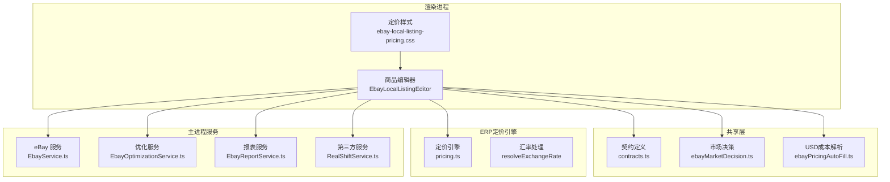
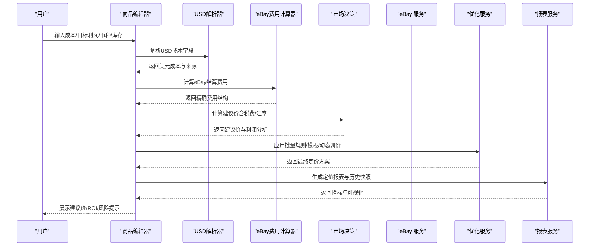
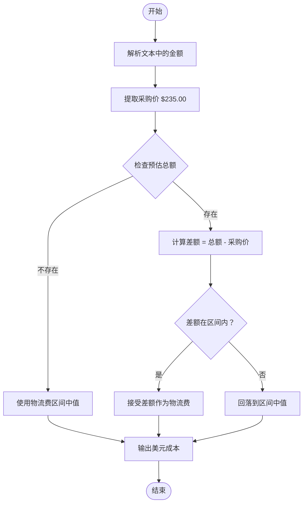
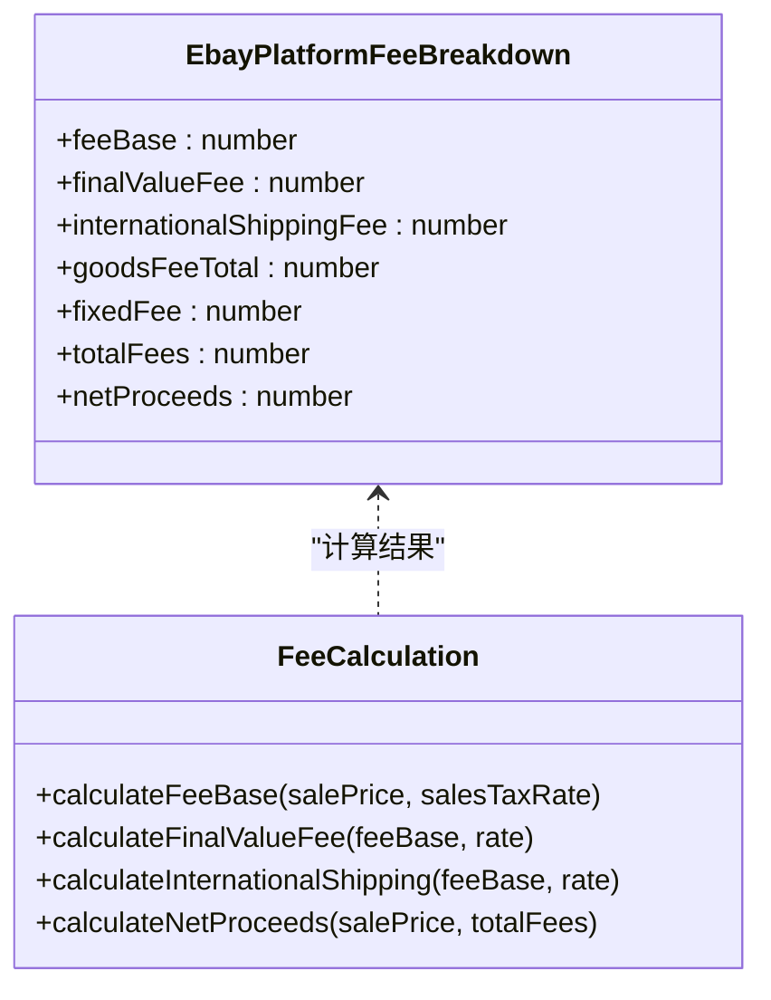
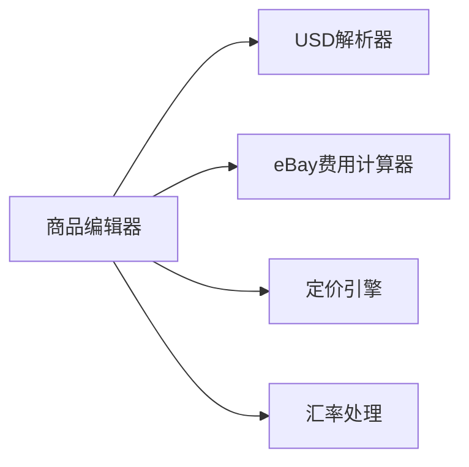

# 定价计算引擎

<cite>
**本文引用的文件**   
- [ebayPricingAutoFill.ts](file://src/shared/ebayPricingAutoFill.ts)
- [pricing.ts](file://server/src/modules/erp/pricing.ts)
- [App.tsx](file://src/renderer/App.tsx)
- [ebayPricingAutoFill.test.ts](file://src/shared/__tests__/ebayPricingAutoFill.test.ts)
- [pricing.test.ts](file://server/src/modules/erp/__tests__/pricing.test.ts)
- [selectionExtract.ts](file://src/shared/selectionExtract.ts)
</cite>

## 更新摘要
**变更内容**   
- 新增USD成本字段解析与自动填充功能
- 实现eBay结算页面费用结构精确计算
- 完善汇率处理与多币种支持机制
- 增强定价算法的准确性与可靠性

## 目录
1. [简介](#简介)
2. [项目结构](#项目结构)
3. [核心组件](#核心组件)
4. [架构总览](#架构总览)
5. [详细组件分析](#详细组件分析)
6. [USD成本字段解析系统](#usd成本字段解析系统)
7. [eBay结算页面费用结构](#ebay结算页面费用结构)
8. [汇率处理与多币种支持](#汇率处理与多币种支持)
9. [依赖关系分析](#依赖关系分析)
10. [性能考量](#性能考量)
11. [故障排查指南](#故障排查指南)
12. [结论](#结论)
13. [附录](#附录)

## 简介
本技术文档围绕 eBay 本地商品编辑器的"定价计算引擎"展开，系统化阐述成本计算、利润分析、市场定价策略与动态价格调整的实现思路。最新升级引入了USD-based成本字段解析、eBay结算页面费用结构精确计算、以及完善的汇率处理机制，确保定价计算的准确性和平台合规性。

## 项目结构
本项目采用 Electron 架构，前端渲染进程负责用户交互与定价界面，主进程服务层提供数据获取、分析与报告生成能力，共享模块定义契约与市场决策逻辑。定价相关的关键位置包括：
- 渲染层：商品编辑器与定价面板（含样式）
- 共享层：契约定义、市场决策模型、USD成本解析
- 主进程服务：eBay 服务、优化服务、报表服务、第三方服务桥接
- ERP定价引擎：多平台定价规则与汇率处理

**图表来源**
- [ebayPricingAutoFill.ts:1-169](file://src/shared/ebayPricingAutoFill.ts#L1-L169)
- [pricing.ts:1-395](file://server/src/modules/erp/pricing.ts#L1-L395)
- [App.tsx:3630-3639](file://src/renderer/App.tsx#L3630-L3639)

## 核心组件
- **USD成本解析器**：从货盘和下载档案中解析美元成本字段，支持采购价、物流费的智能推导
- **eBay费用计算器**：精确模拟eBay后台结算页面的费用结构，包含计费基数、成交费、国际运费等
- **多平台定价引擎**：统一的定价算法，支持eBay、Amazon、Ozon等多平台
- **汇率处理系统**：实时汇率获取、缓存、回退机制，支持多币种换算
- **商品编辑器与定价面板**：承载定价输入、展示计算结果、驱动批量与模板操作

**章节来源**
- [ebayPricingAutoFill.ts:1-169](file://src/shared/ebayPricingAutoFill.ts#L1-L169)
- [pricing.ts:1-395](file://server/src/modules/erp/pricing.ts#L1-L395)
- [App.tsx:3630-3639](file://src/renderer/App.tsx#L3630-L3639)

## 架构总览
定价计算引擎遵循"输入—解析—计算—策略—输出—反馈"的闭环：
- **输入**：成本、运费、税费、平台佣金、目标利润率、币种、库存、竞品价格、促销计划
- **解析**：USD成本字段解析、汇率换算、费用结构匹配
- **计算**：成本汇总、税费折算、利润测算、eBay费用精确计算
- **策略**：市场定价、动态调价、批量规则、模板套用
- **输出**：建议售价、折扣价、促销价、ROI 指标
- **反馈**：价格监控、销量转化、A/B 实验、历史追踪

**图表来源**
- [ebayPricingAutoFill.ts:61-92](file://src/shared/ebayPricingAutoFill.ts#L61-L92)
- [ebayPricingAutoFill.ts:136-145](file://src/shared/ebayPricingAutoFill.ts#L136-L145)
- [pricing.ts:74-93](file://server/src/modules/erp/pricing.ts#L74-L93)

## 详细组件分析

### USD成本字段解析系统
新引入的USD成本解析系统能够从货盘和下载档案的文本事实中智能解析美元口径的成本取值：

- **采购价解析**：从`$235.00`格式的文本中提取采购成本
- **物流费推导**：优先使用"预估总额 - 采购价"，超出范围时回落到区间中值
- **智能容错**：支持多种文本格式，提供详细的中文提示
- **凭据记录**：记录取值来源，支持"填充一次后不再覆盖手改"

**图表来源**
- [ebayPricingAutoFill.ts:61-75](file://src/shared/ebayPricingAutoFill.ts#L61-L75)

**章节来源**
- [ebayPricingAutoFill.ts:1-92](file://src/shared/ebayPricingAutoFill.ts#L1-L92)
- [ebayPricingAutoFill.test.ts:23-67](file://src/shared/__tests__/ebayPricingAutoFill.test.ts#L23-L67)

### eBay结算页面费用结构
实现了与eBay后台结算页面完全一致的费用计算逻辑：

- **计费基数**：售价 + 代收销售税
- **成交费率**：按类目匹配不同费率（乐器6.7%、书籍15.3%、家居12.7%、汽配11.5%、通用13.6%）
- **国际运费**：跨境发货按计费基数收取
- **固定费用**：每单固定成交费
- **净收益**：售价 - 总费用（仅对账，不扣采购/物流）

**图表来源**
- [ebayPricingAutoFill.ts:122-145](file://src/shared/ebayPricingAutoFill.ts#L122-L145)

**章节来源**
- [ebayPricingAutoFill.ts:109-145](file://src/shared/ebayPricingAutoFill.ts#L109-L145)
- [ebayPricingAutoFill.test.ts:91-110](file://src/shared/__tests__/ebayPricingAutoFill.test.ts#L91-L110)

### 多平台定价引擎
统一的定价算法支持多个电商平台：

- **公式统一**：landedCost = (costPrice + shippingCost) × exchangeRate
- **目标利润**：target = landedCost × markupRate
- **佣金反推**：gross = target / (1 − commissionRate)
- **最终价格**：price = round2(gross + fixedFee)

**章节来源**
- [pricing.ts:10-16](file://server/src/modules/erp/pricing.ts#L10-L16)
- [pricing.ts:74-93](file://server/src/modules/erp/pricing.ts#L74-L93)

### 汇率处理与多币种支持
完善的汇率处理机制确保多币种定价的准确性：

- **实时汇率**：支持CNY→USD、USD→CNY等双向换算
- **配置表管理**：通过环境变量配置汇率表
- **同币种优化**：同币种汇率直接返回1
- **错误处理**：缺失汇率时抛出明确错误信息

**章节来源**
- [pricing.ts:38-49](file://server/src/modules/erp/pricing.ts#L38-L49)
- [pricing.test.ts:71-84](file://server/src/modules/erp/__tests__/pricing.test.ts#L71-L84)

## USD成本字段解析系统

### 核心功能特性
1. **智能文本解析**：支持多种货币格式（$235.00、USD 1,320.50）
2. **物流费智能推导**：优先使用差额法，回落到区间中值
3. **详细来源追踪**：记录每个成本值的来源和计算过程
4. **容错机制**：异常输入不会导致NaN或崩溃

### 支持的输入格式
- 采购价：`$235.00`、`USD 1,320.50`
- 预估总额：`$282.68 /件`
- 物流费区间：`$23.35 -$65.80 /件`、`$20.63~$40.30 /件`
- 单值物流费：`物流费：$30.00 /件`

**章节来源**
- [ebayPricingAutoFill.ts:41-49](file://src/shared/ebayPricingAutoFill.ts#L41-L49)
- [ebayPricingAutoFill.ts:51-58](file://src/shared/ebayPricingAutoFill.ts#L51-L58)

## eBay结算页面费用结构

### 费用计算流程
1. **计费基数计算**：`feeBase = salePrice × (1 + salesTaxRate/100)`
2. **成交费计算**：`finalValueFee = feeBase × finalValueFeeRate/100`
3. **国际运费计算**：`internationalShippingFee = feeBase × internationalShippingRate/100`
4. **商品总费用**：`goodsFeeTotal = finalValueFee + internationalShippingFee`
5. **总费用**：`totalFees = goodsFeeTotal + fixedFee`
6. **净收益**：`netProceeds = salePrice - totalFees`

### 类目费率规则
- **乐器类目**：6.7%
- **高客单运动鞋**（≥$150）：8%
- **书籍、影音类目**：15.3%
- **家居与园艺**（≤$2,500）：12.7%
- **汽配件**（≤$1,000）：11.5%
- **通用类目**：13.6%

**章节来源**
- [ebayPricingAutoFill.ts:136-145](file://src/shared/ebayPricingAutoFill.ts#L136-L145)
- [ebayPricingAutoFill.ts:152-163](file://src/shared/ebayPricingAutoFill.ts#L152-L163)

## 汇率处理与多币种支持

### 汇率解析机制
- **优先级**：配置表 > 同币种(1) > 抛错
- **大小写不敏感**：cny->usd 与 CNY->USD 等价
- **错误处理**：缺失汇率时抛出 `ERP_FX_MISSING` 错误

### 默认定价规则
- **eBay**：markupRate=2.2, commissionRate=0.13, fixedFee=0.3, currency='USD'
- **Amazon**：markupRate=2.5, commissionRate=0.15, fixedFee=0, currency='USD'
- **Ozon**：markupRate=2.4, commissionRate=0.12, fixedFee=0, currency='RUB'

**章节来源**
- [pricing.ts:27-32](file://server/src/modules/erp/pricing.ts#L27-L32)
- [pricing.ts:38-49](file://server/src/modules/erp/pricing.ts#L38-L49)

## 依赖关系分析
- **组件耦合**：
  - 商品编辑器依赖USD解析器和eBay费用计算器
  - ERP定价引擎通过接口抽象，便于替换与扩展
- **外部依赖**：
  - eBay API：类目、费用、竞品、价格基准
  - 汇率服务：实时汇率获取
- **潜在循环依赖**：
  - 通过契约与服务隔离，避免渲染层与服务层直接互相引用

**图表来源**
- [ebayPricingAutoFill.ts:1-169](file://src/shared/ebayPricingAutoFill.ts#L1-L169)
- [pricing.ts:1-395](file://server/src/modules/erp/pricing.ts#L1-L395)

## 性能考量
- **缓存策略**：汇率、类目费用、竞品价格缓存，减少重复请求
- **异步处理**：批量计算与报表生成使用队列与分页
- **增量更新**：价格历史与指标增量计算，避免全量重算
- **降级策略**：外部服务不可用时的回退与容错

## 故障排查指南
- **常见问题**：
  - USD成本解析失败：检查文本格式是否正确
  - 汇率获取失败：检查配置表和网络连接
  - eBay费用计算异常：核对类目和费率设置
  - 动态调价未生效：检查规则与阈值配置
- **调试建议**：
  - 打印USD成本解析结果和来源
  - 记录eBay费用计算的中间步骤
  - 开启汇率获取日志

**章节来源**
- [ebayPricingAutoFill.test.ts:50-67](file://src/shared/__tests__/ebayPricingAutoFill.test.ts#L50-L67)
- [pricing.test.ts:55-84](file://server/src/modules/erp/__tests__/pricing.test.ts#L55-L84)

## 结论
本定价计算引擎通过引入USD成本字段解析、eBay结算页面费用结构精确计算、以及完善的汇率处理机制，实现了从成本到利润、从市场到策略、从静态到动态的全链路定价能力。新的USD解析系统能够智能地从各种文本格式中提取成本信息，eBay费用计算器确保了与平台结算页面的完全一致性，而多币种支持则为全球化业务提供了坚实基础。

## 附录
- **术语表**：
  - USD成本：以美元计价的采购成本和物流成本
  - 计费基数：eBay计算费用的基础金额（售价+销售税）
  - 净收益：售价减去平台费用后的金额
  - 汇率换算：不同货币之间的价值转换
- **最佳实践**：
  - 定期检查USD成本解析的准确性
  - 维护准确的类目费率配置
  - 监控汇率波动对定价的影响
  - 定期验证eBay费用计算的准确性